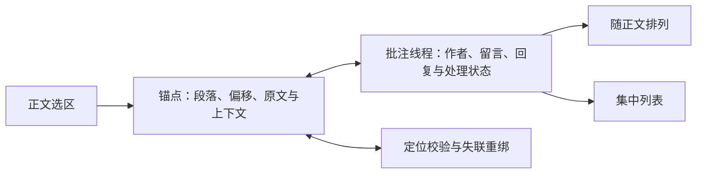

# 正文关联批注设计

## 目标与原则

批注围绕正文中的明确内容展开。阅读时以轻量标记为主，处理时能够准确找到对应意见；打开、折叠、切换视图不会复制批注或改变它所关联的正文。

优先级依次为：正文阅读连贯、定位准确、交互低干扰。存在歧义时保留意见并标为失联，不把批注悄悄挂到另一处相似文字上。

## 数据与视图



两种模式使用同一份锚点与批注线程。排列位置、悬停高亮、连接线和展开状态属于运行时界面；作者、留言、回复、处理状态及锚点随 HTML 保存。

## 创建批注

1. 用户在正文中选中文字，通过浮动“＋ 批注”按钮或 Ctrl / ⌘ + Alt + M 创建批注。
2. 表单显示引文，填写署名、意图与内容。署名用于本地文档中的作者展示，不是登录账户。
3. 提交后建立锚点，正文出现低饱和度背景色标记，右侧生成卡片；新建和回复沿用当前署名。
4. 保留“建议修改”“请保留”“讨论”三类意图。旧数据没有作者时显示“未署名”，不推断作者身份。

未提交的新建、编辑和回复草稿只在当前标签页内保留；切换模式不会清掉草稿。提交后，再通过原文件保存或 HTML 导出写入文件。模板不使用浏览器缓存保存草稿。

## 两种展示模式

| 模式 | 主要用途 | 排列与滚动 |
| --- | --- | --- |
| 随正文排列 | 逐段阅读和讨论，宽屏默认模式 | 卡片按正文锚点纵向位置排列；相邻卡片保持间距，重叠时按正文顺序向下避让；整页随正文滚动 |
| 集中列表 | 批量查看、筛选和处理 | 使用固定侧栏，内容独立滚动；支持全部、待处理、失联筛选 |

随正文模式中，卡片直接放在文档留白区域，不再套一层白色大容器；卡片内部的引用使用左竖线，留言和回复用间距或细线分组。集中列表使用一个白色抽屉，内部条目不重复套卡片。对应层级共用目录、正文的圆角与边框样式。

宽屏保留所选模式。900 px 及以下自动使用集中列表，并明确提示；此时模式选择不可切换，恢复宽屏后恢复原先选择。汇报模式下，随正文视图只排列当前主题有可见锚点的卡片；其他主题的意见可在集中列表查看。

失联批注保留在列表中；随正文模式将无法定位的卡片排在文档后部，并在栏头提示失联数量。

## 联动与渐进展开

- 点击正文标记，打开批注栏、激活对应卡片，并在需要时将卡片带入视野；点击卡片引文或“定位正文”返回原文。
- 悬停正文标记或卡片只做联动预览，不自动翻页、滚动或展开全文；点击或键盘激活后才完整展开。
- 正常状态没有连接线。仅在激活或悬停预览、且正文与卡片均可见时显示一条连接线，放在正文右侧留白中；关闭侧栏或窄屏时隐藏。
- 非激活卡片的长留言默认预览四行，讨论记录默认折叠；激活后显示全文和全部回复，也可通过明确的展开／收起按钮操作。
- 卡片包含作者、时间、原文位置、意图、内容、回复和处理状态。支持编辑、删除、解决、重新打开；解决后的留言加删除线。
- 批注栏独立开关。关闭后正文保留轻量标记，再次点击可恢复关联查看。
- 仅“导出批注清单”等导出／链接操作使用蓝色下划线。编辑、回复、删除、定位和收起保持轻量按钮，悬停与键盘聚焦时反馈。

## 锚点与失联处理

锚点包含稳定的段落 ID、字符起止位置、当前引文、原始引文、前后文和文本指纹。偏移量使用 DOM 的 UTF-16 单元；外部工具处理 emoji 等内容时应遵循同一约定。

定位按以下证据处理：

1. 段落和文本指纹一致时，使用保存的偏移量。
2. 文本变化时，在同一段落中核对引文与上下文；只有唯一匹配或上下文能够唯一判定时才恢复位置。
3. 正文编辑时结合实际编辑范围更新位置。段前插入文字只移动偏移；局部改写更新当前引文，保留原始引文。
4. 整段替换、原文删除或多个候选无法区分时标为失联。不能仅凭新旧文本共同的句号或其他标点继续关联。

失联不删除批注和讨论。用户点击“重新关联”，在正文中重新选区，再通过浮动“关联选区”按钮或同一快捷键确认。更新锚点时保留最近五次旧锚点记录，便于理解原来的意见。取消重绑不改变原有关系。

## 保存与兼容

当前批注 JSON 采用版本 4：

| 内容 | 主要字段 |
| --- | --- |
| 文档偏好 | `preferences.viewMode`、`preferences.author` |
| 批注线程 | `id`、`chapterId`、`intent`、`anchors`、`messages`、`resolved` |
| 留言／回复 | `id`、`author`、`text`、`createdAt`、可选 `editedAt` |
| 锚点 | `blockId`、`start`、`end`、`quote`、`originalQuote`、`prefix`、`suffix`、`textHash` |
| 失联与重绑 | 锚点上的 `orphaned`、`reason`；线程上的 `anchorHistory` |
| 处理记录 | 可选 `resolvedAt`、`resolvedBy` |

读取旧批注时允许缺少新增字段；不丢弃原有引文、意图和讨论。新建空白模板会清空线程与历史，恢复默认模式和署名。保存时排除运行时卡片、连接线、选区工具栏、编辑属性和临时标记。

原文件写回权限与浏览器兼容性沿用[PRD](设计方案.md)的边界。结构化数据和正文均随同一个 HTML 交付；没有额外 JSON、缓存或服务器依赖。

## 后续扩展

笔记、疑问、修改建议和 AI 解读可在现有锚点与线程上增加类型和消息角色；AI 对话同样需要保留选区、上下文、轮次与来源，并将采用的结果整理成有来源的文档笔记。

当前交付包含人工批注与多轮回复，没有内置 AI 调用或占位聊天按钮。离线模板可由外部 AI 读取与处理；如要在 HTML 内调用在线 AI，需要另行定义联网形态、授权与密钥管理，不能悄悄改变单文件离线约束。

## 验收入口

完整页面交互见[批注联动验收](批注联动验收.md)。锚点及避让逻辑检查：

```sh
node scripts/check_annotation_logic.mjs
```
